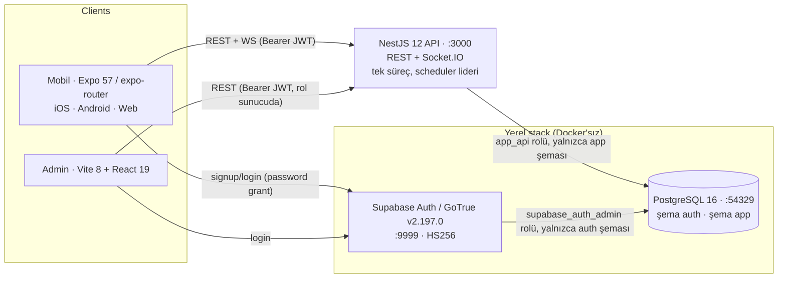

# Mimari — M0

Uygulanmış sistemi anlatır (hedef değil). Son güncelleme: 2026-10-15.

## 1. Süreçler ve bileşenler



- **Tek API süreci**: HTTP (Express), Socket.IO gateway ve canlı oturum zamanlayıcısı aynı Node sürecinde. Redis yok. İkinci bir süreç yanlışlıkla açılırsa HTTP/WS sunar ama zamanlayıcıyı ilerletmez (bkz. §4.3).
- **Kimlik**: Supabase Auth JWT’leri. API, `sub`’dan kullanıcı kimliğini alır; `iss`, `aud`, `exp`, imza ve `alg` zorunlu. HS256 gizli anahtar (yerel) veya JWKS (hosted) — `apps/api/src/modules/identity/jwt-verifier.ts`.
- **Veri**: Tek PostgreSQL. GoTrue `auth` şemasında, uygulama `app` şemasında. API rolü `auth`’u okuyamaz; Data API rolleri `app`’e giremez (K02 testi).
- **Arka plan işleri**: Ayrı worker yok; zamanlayıcı API içinde (M0 ihtiyacı yok).
- **Analitik**: Sağlayıcıdan bağımsız olay şeması `app.analytics_events`; sunucu olguları (`producer=server`) ile istemci iddiaları (`producer=client`) ayrı.

## 2. Modül sınırları (modüler monolit)

`apps/api/src/modules/*` — hepsi tek Nest uygulamasında; veri sahipliği tabloya göre açıktır, modüller başka modülün tablosuna doğrudan yazmaz (servis çağırır).

| Modül | Sorumluluk | Sahip olduğu tablolar |
|---|---|---|
| identity | JWT doğrulama, `AuthGuard`, `RolesGuard` (rol DB’den) | — |
| profiles | Profil bootstrap (ilk `GET /me`), güncelleme, rol okuma | `profiles` |
| editorial-content | Konular, kart/Radar içerik ve revizyonları, yayın yaşam döngüsü | `topics`, `content_items`, `content_revisions` |
| learning-progress | Kaydetme, tamamlama, XP defteri, günlük görev | `saved_items`, `learning_completions`, `learning_xp_events`, `daily_task_completions` |
| question-bank | Soru + revizyon + seçenek + **sunucuya özel cevap anahtarı**, inceleme yaşam döngüsü, planlanabilirlik ve yeniden doğrulama | `questions`, `question_revisions`, `question_options`, `question_answer_keys` |
| live-quiz | Oturum oluşturma/iptal, katılım, snapshot, durum makinesi geçişleri, zamanlayıcı + kilit, WS gateway, cevap kabulü | `quiz_sessions`, `session_questions`, `session_participants`, `answer_receipts` |
| scoring-results | Sıralama ve kanonik sonuç satırları, sonuç görünümü | `session_results` |
| analytics | Sunucu olayı kaydı, istemci olayı alımı, aktif kullanıcı örnek sorgusu | `analytics_events` |
| admin-audit | Denetim kaydı | `admin_audit_log` |
| admin | Dar yönetim API’si (editör/admin rolleri) | — |
| home / health | Ana sayfa birleşimi; `/health`, `/ready`, `/time` | — |

## 3. Veri modeli

Şema: `apps/api/src/db/schema/index.ts`; SQL: `apps/api/drizzle/*.sql`. Gizlilik: **P0** yayınlanmış içerik, **P1** kullanıcıya özel, **P2** sunucuya özel sır.

| Tablo | Sahip | Kritik unique / kısıt | Temel indeks | Gizlilik |
|---|---|---|---|---|
| profiles | profiles | `username` unique; `id` = auth user id (FK yok, bilinçli) | — | P1 (e-posta saklanmaz) |
| topics | editorial-content | `slug` unique | sort_order | P0 |
| content_items | editorial-content | `slug` unique; `published_revision_id` kullanıcıların gördüğü sabit revizyon | (status, kind), topic | P0 (yayın) |
| content_revisions | editorial-content | (content_item_id, version) unique | — | P0/P1 |
| saved_items | learning | PK (user_id, content_item_id) | — | P1 |
| learning_completions | learning | (user_id, content_item_id) unique → XP bir kez | (user_id, completed_at) | P1 |
| learning_xp_events | learning | (user_id, reason, ref_id) unique; amount > 0; reason yalnızca `content_completed` | user_id | P1 |
| daily_task_completions | learning | (user_id, task_key, local_date) unique | — | P1 |
| questions | question-bank | `approved_revision_id` yeni revizyonda sıfırlanır; `approval_kind` (`editor_review` / `automated_test`) yalnızca onay varken dolu (CHECK) | status, topic | P1 |
| question_revisions | question-bank | (question_id, version) unique; satırlar değişmez | — | P0 (reveal sonrası) |
| question_options | question-bank | (question_revision_id, position) unique | — | P0 (açıldıktan sonra) |
| question_answer_keys | question-bank | PK question_revision_id | — | **P2** |
| quiz_sessions | live-quiz | CHECK `prize_mode='none' AND is_test`; `rules` JSON dondurulur; `state_version` | (status, scheduled_start_at) | P0 |
| session_questions | live-quiz | (session_id, position), (session_id, question_id) unique; `closes_at > opens_at` | status | P0 (açıldıktan sonra) |
| session_participants | live-quiz | (session_id, user_id) unique; `participation_token_hash` | session_id | P1 / **P2** (hash) |
| answer_receipts | live-quiz | (session_question_id, participant_id) unique; (participant_id, idempotency_key) unique; points 0–100 | (session_id, participant_id) | P1 |
| session_results | scoring-results | (session_id, participant_id) unique; rank ≥ 1 | user_id | P0 (sıralama) / P1 |
| analytics_events | analytics | PK = üretici event_id (tekrar düşer) | (event_name, event_time), (user_id, event_time) | P1 |
| admin_audit_log | admin-audit | — | created_at | P1 |

Yetki: tüm `app` tabloları `app_api` sahipliğinde; `anon`, `authenticated`, `service_role`, `PUBLIC` için REVOKE; RLS tüm tablolarda açık (politika yok → sahip dışı erişim yok). `auth` şemasına `app_api` giremez.

## 4. Canlı akış

### 4.1 Durum makineleri (kalıcı)

- Oturum: `draft → scheduled → lobby → live → completed`; her ara durumdan `cancelled` (terminal). Admin oluşturma doğrudan `scheduled` üretir.
- Soru: `pending → open → closed → revealed`. M0’da `closesAt`’te `open → closed → revealed` tek transaction’da uygulanır; iptalde `open → closed` (reveal yok).
- Her geçiş `quiz_sessions.state_version`’ı artırır; WS olayları ve snapshot bu sürümü taşır; istemci küçük/eşit sürümü atar.

### 4.2 Zaman çizgisi

```mermaid
sequenceDiagram
  participant Admin
  participant API as API (scheduler + gateway)
  participant DB
  participant U1 as Kullanıcı 1
  participant U2 as Kullanıcı 2
  Admin->>API: POST /admin/sessions (5 published soru, start T)
  API->>DB: quiz_sessions(scheduled, rules dondurulur) + session_questions(revision pin)
  U1->>API: POST /quiz/sessions/:id/join  → participationToken
  U2->>API: POST /quiz/sessions/:id/join
  U1->>API: WS session.subscribe(token) → ack snapshot
  Note over API: tick her 250 ms; yalnızca advisory lock sahibi
  API->>DB: T−60s: scheduled→lobby (soru revizyonları yeniden doğrulanır)
  API-->>U1: session.lobby (v)
  API->>DB: T: open Q1 (opensAt=now, closesAt=now+12s), live
  API-->>U1: question.opened (kişiye özel seçenek sırası, anahtar yok)
  U1->>API: POST answers {sessionQuestionId, optionId, idempotencyKey, token}
  API->>DB: FOR UPDATE participant; pencere/uygunluk/seçenek; puan; INSERT receipt
  API-->>U1: receipt (doğruluk/puan YOK)
  API->>DB: closesAt: open→revealed
  API-->>U1: question.revealed (doğru seçenek, açıklama, kendi sonucu)
  API->>DB: +6s: sonraki soru … son sorudan sonra completed + session_results
  API-->>U1: session.completed → GET result
```

### 4.3 Tek otorite ve tekrar güvenliği

- `SchedulerLeaderService`: süreç ömrü boyunca ayrı bir bağlantıda `pg_try_advisory_lock(7283001)`. Kilit alınamazsa süreç “lider değil”: `/ready` `schedulerLeader:false` döner, uyarı loglanır, geçiş yapılmaz. Bağlantı düşerse kilit otomatik serbest kalır.
- Her tick önce `verify()` ile kilidin hâlâ bu bağlantıda tutulduğunu `pg_locks` üzerinden doğrular (3 sn zaman aşımı; cevap vermeyen bağlantı yok edilir ve liderlik bırakılır). Doğrulanamazsa o tick hiçbir geçiş yapmaz.
- Açılışta kilidi alan süreç `recoverAfterRestart` çalıştırır (lobi/canlı oturumlar `server_restart` ile iptal, kaçırılmış planlı başlangıçlar `missed_start`). Lider olmayan süreç 10 sn’de bir `takeOver()` dener: daha önce hiç lider olmamış bir süreç kilidi alırsa önceki liderin yarıda kalan oturumlarını aynı kuralla iptal eder (sıralamaya sokmaz); kendi kilit bağlantısı kopup geri gelen önceki lider ise kalıcı durumdan devam eder. Sağlıklı lider kilidi tutarken açılan ikinci süreç hiçbir oturumu iptal etmez veya ilerletmez (test: `08-closeout-risks` R4).
- Her geçiş `SELECT … FOR UPDATE` ile oturum satırını kilitler ve ön koşulu kilit içinde yeniden kontrol eder (`WHERE status='pending'` vb.). Tekrarlanan iş 0 satır etkiler → no-op (K10 testi: paralel tick’lerden yalnızca biri uygular).
- Broadcast, commit’ten **sonra** yapılır; kaçan olaylar istemcinin bekçi köpeği (watchdog) ile `state.resync` isteğiyle telafi edilir.

### 4.4 Cevap kabulü (`AnswersService.submit`)

1. `receivedAt` = gövde tamamen alındıktan sonra middleware’in damgaladığı süreç saati (yavaş gövdeyle kapanıştan sonra seçim yapılamaz; kuyruk/işlem süresi dahil değil).
2. Oturum satırı `FOR KEY SHARE`: cevap transaction’ı geçişlerle (`FOR UPDATE`) seri çalışır; tamamlanmış/iptal edilmiş oturuma makbuz yazılmaz.
3. Katılımcı satırı `FOR UPDATE` (aynı katılımcının eşzamanlı istekleri seri) ve katılım token’ı hash eşleşmesi.
4. Aynı `idempotencyKey` → aynı payload ise aynı makbuz (`replayed:true`, oturum bittikten sonra da), farklı payload ise `IDEMPOTENCY_KEY_CONFLICT`.
5. Başka anahtarla ikinci cevap → `ANSWER_ALREADY_ACCEPTED`.
6. Oturum durumu: `cancelled` → `SESSION_CANCELLED`, `completed` → `SESSION_COMPLETED`, `live` değilse `QUESTION_NOT_OPEN`.
7. Pencere yalnızca zaman damgalarıyla: `opensAt <= receivedAt < closesAt`. Kapanıştan önce alınmış ama reveal’den sonra işlenen istek kabul edilir; kapanış anında ve sonrasında ret.
8. Geç katılım uygunluğu; seçeneğin sabitlenmiş revizyona aitliği (başka sorunun seçeneği `OPTION_INVALID`, hak tüketmez).
9. Puan sunucuda hesaplanır ve makbuzla **aynı transaction’da** yazılır; istemciye reveal’e kadar dönmez.
10. DB tekil kısıtları son savunma hattıdır; 2–3. adımlardaki kilitler nedeniyle 23505 yeniden deneme yolu API üzerinden tetiklenemez ve testle kanıtlanmış değildir.

Bilinçli sınır: son sorunun cevabı, oturum tamamlanmadan (kapanıştan `revealDurationMs` = 6 sn sonra) işlenmelidir. Daha geç işlenen istek, zamanında alınmış olsa bile `SESSION_COMPLETED` alır; sonuçlar tamamlanmada kesinleşir ve M0’da sonradan değişmez (sürümlü düzeltme M1).

### 4.5 Sızıntı sınırı

- `packages/contracts` cevap anahtarı içermez. `OpenQuestionView` yalnızca açık sorunun metni ve seçenekleri; `pending` sorular snapshot’ta yoktur (K09 testi JSON’da arar).
- `RevealView`/sonuç yalnızca `closedAt` sonrası üretilir. `answer_receipts.is_correct/points` istemciye reveal öncesi gönderilmez.
- Admin uçları roller sunucuda doğrulanarak açılır; `anon/authenticated` DB rolleri `question_answer_keys`’e erişemez.
- Loglarda `authorization`, `participationToken`, `password` maskelenir.

## 5. Güvenlik ve hata davranışları

| Konu | Uygulama |
|---|---|
| Kimlik | Bearer JWT (REST), handshake `auth.token` (WS). Süresi dolmuş → `AUTH_TOKEN_EXPIRED`, bozuk/yanlış issuer/aud/imza → `AUTH_INVALID_TOKEN`. |
| Yetki | `profiles.role ∈ {member, editor, admin}` DB’den; `@Roles()` ile uç bazında. |
| Sınırlar | JSON gövde 32 KB; genel 600 istek/dk; cevap ucu 30 istek/10 sn (kullanıcı bazlı). |
| İstemci iddiaları | `AnswerSubmitInput` bilinmeyen alanları atar; `clientSentAt/clientRttMs` yalnızca tanı için saklanır. |
| API yeniden başlatma | Bootstrap’te lider ise: lobby/live oturumlar `server_restart` ile iptal, açık sorular kapatılır, makbuzlar korunur; 60 sn’den fazla kaçırılan planlı oturumlar `missed_start`. |
| Onay geri çekilmesi / düzenleme | Lobi ve başlangıç öncesi sabitlenmiş revizyonlar yeniden doğrulanır (yalnızca `published`); geçersizse oturum `question_approval_withdrawn` / `question_revision_changed` ile iptal. Katılımcı okunur bir gerekçe görür, soru kimliği denetim kaydında kalır. Konu ve ilgili kart da revizyonla birlikte sabitlenir; sonradan yapılan onaysız düzenleme bitmiş oturumun sonuç ekranını değiştirmez. |
| WS kopması | Gateway üyeliği düşer, `connection_interrupted` olayı; istemci yeniden bağlanınca `session.subscribe` → snapshot. |
| Bilinmeyen teslim | İstemci ağ hatasında aynı anahtarla 3 deneme; yine olmazsa “iletilemedi” gösterir, başarı uydurmaz; `GET /quiz/sessions/:id/answers/:key` ile makbuz sorgulanır. |
| Sağlık | `/health` (liveness), `/ready` (DB ping + lider bilgisi), `/time` (gösterim için saat ofseti). |

## 6. Teknoloji sürümleri (sabitlenmiş, 2026-10-14/15 kontrol)

Node 22.22.0 (`.node-version`), pnpm 10.28.0, TypeScript 5.9.3, NestJS 12.1.3, Socket.IO 4.8.4, Drizzle ORM 0.45.4 / drizzle-kit 0.31.11, pg 8.23.1, zod 4.6.7, jose 6.2.12, nestjs-pino 5.3.1 / pino 10.4.0, Vitest 5.0.4 + unplugin-swc 2.0.0, Expo 57.0.29, React Native 0.86.3, React 19.2.3, expo-router 57.0.27, react-native-web 0.21, @supabase/auth-js 2.117.3, Vite 8.3.4, Playwright 1.64.1, PostgreSQL 16, GoTrue v2.197.0. Kaynak: npm registry ve Expo `bundledNativeModules.json` (uygulama günü).

## 7. İlk dağıtım (tarif, uygulanmadı)

Uzun ömürlü WebSocket bağlantısı taşıyan tek container/VM (ör. Fly.io, Railway, Hetzner VM) + yönetilen PostgreSQL (Supabase projesi: Auth + Postgres aynı yerde). API tek instance; `/ready` ile liderlik izlenir. Ortam değişkenleri `apps/api/.env.example` ile aynı; hosted Supabase için `SUPABASE_JWKS_URL` ve `AUTH_JWT_ISSUER=https://<ref>.supabase.co/auth/v1`. Çoklu instance Redis adapter ile M1 ölçümlerinden sonra.

## 8. Bilinen sınırlar

- Ağ gecikmesi puana yansır (sunucu alım zamanı); adalet iddiası yoktur.
- Tek süreç; yatay ölçek yok. İkinci süreç yalnızca kilit boşalınca devralır ve yarıda kalan oturumları iptal eder (bkz. §4.3).
- Puan ve zaman damgaları monoton olmayan sistem saatine (`Date.now()`) dayanır; sunucu saatinin oturum sırasında atlaması M1 risk kaydına eklendi.
- Native doğrulama bu ortamda yapılmadı (web önizleme ile doğrulandı).
- Reveal yayını kişiye özel olduğundan üye başına bir emit; ~binlerce kullanıcıda ölçülmeli.
- İçerik görselleri yok (lisans belirsizliği), yalnızca metin.
